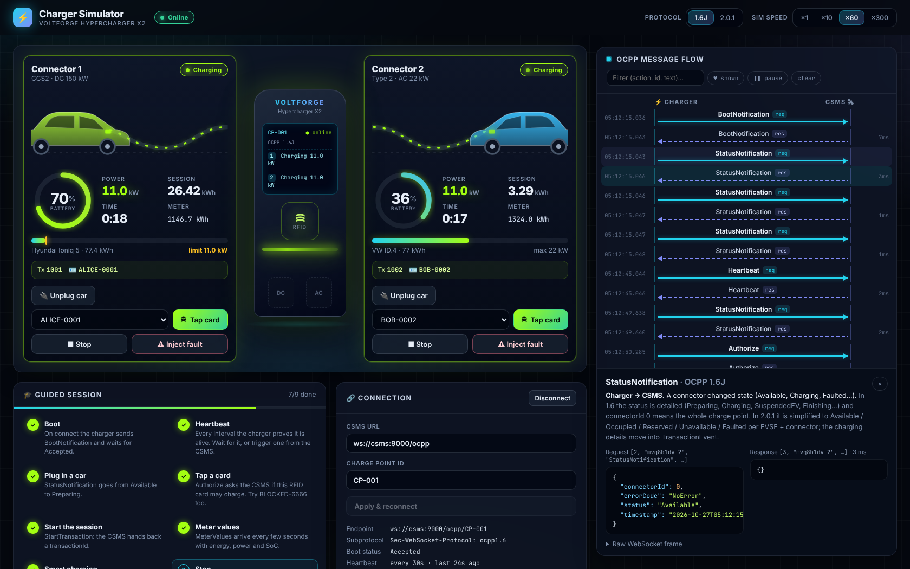
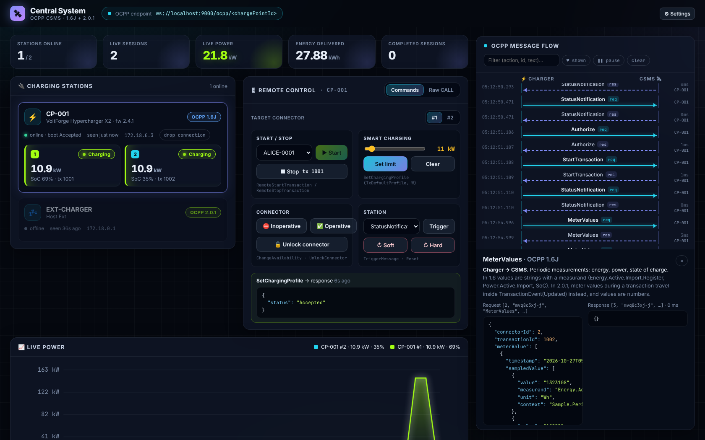
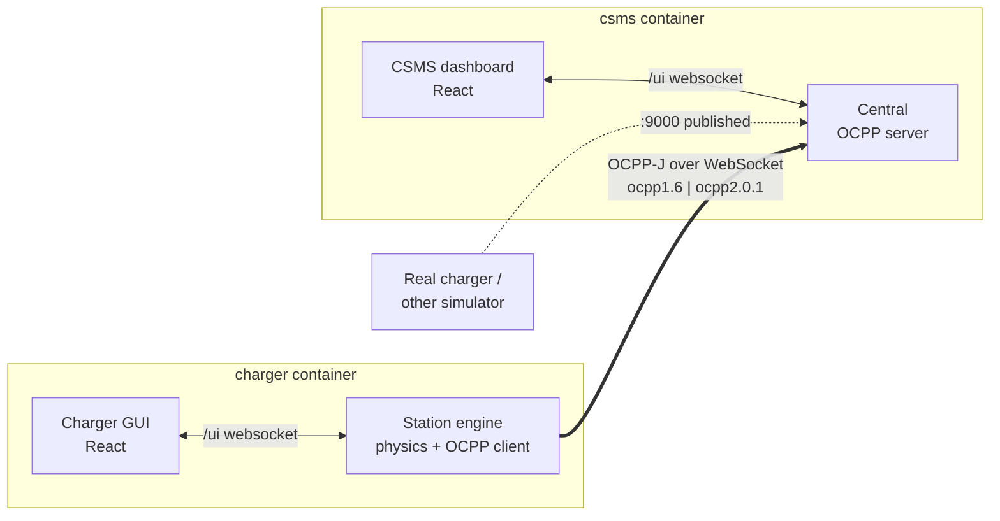

# ⚡ OCPP EV Charger Simulator

Learn **OCPP** by watching it happen. This repo runs two apps that talk to each other over real OCPP WebSockets:

- **Charger simulator**: a two-connector charging station (CCS2 DC 150 kW + Type 2 AC 22 kW). You plug in cars, tap RFID cards and inject faults from a web GUI.
- **CSMS (central system)**: the backend a charge point operator runs. Its dashboard shows stations, live power and sessions, and lets you send remote commands.

Both speak **OCPP 1.6J and OCPP 2.0.1**. You can flip the charger between them live and compare the messages side by side. Every frame on the wire is drawn as a sequence diagram with a plain-English explanation.

| Charger simulator | CSMS dashboard |
| --- | --- |
|  |  |

## Quick start

```bash
docker compose up --build
```

| What | URL |
| --- | --- |
| Charger GUI | http://localhost:8081 |
| CSMS dashboard | http://localhost:8080 |
| **CSMS OCPP endpoint (published)** | `ws://<your-machine>:9000/ocpp/<chargePointId>` |

Port **9000** is published on the host. That means anything on your network can connect to the CSMS: a real charger, another simulator, or your own code. Use subprotocol `ocpp1.6` or `ocpp2.0.1`.

### Without Docker

```bash
npm install
npm run dev         # CSMS on :5173 (backend :8080, OCPP :9000), charger on :5174 (backend :8081)
```

## Things to try

1. **Watch the boot.** Open both GUIs. The charger connects and sends `BootNotification`, then `StatusNotification` for each connector, then a `Heartbeat` every 30 s.
2. **Charge a car.** Plug a car into connector 1 and tap `ALICE-0001`. You'll see `Authorize`, then `StartTransaction` (1.6) or `TransactionEvent(Started)` (2.0.1), then meter values every 5 s.
3. **Get rejected.** Tap `BLOCKED-6666`, `CAROL-0003` (expired) or `UNKNOWN-9999`. Then tap Alice's card on the *other* connector while she's already charging: `ConcurrentTx`.
4. **Smart charging.** In the CSMS, set an 11 kW limit. `SetChargingProfile` arrives and the charger's power drops to the yellow limit marker.
5. **Remote start.** In the CSMS, pick connector 2 and press Start, then plug in a car on the charger.
6. **Switch protocol.** Flip the charger's toggle to **2.0.1** and repeat. Notice how `StartTransaction`/`StopTransaction`/`MeterValues` collapse into one `TransactionEvent`, and how the transaction id is now a UUID made by the charger.
7. **Break things.** Use the CSMS's **Raw CALL** tab to send `Reset` with `{"type":"Bogus"}` (FormationViolation/FormatViolation) or an action the charger doesn't know (NotImplemented). Set the boot policy to *Rejected* and reset the charger.
8. **Speed up time.** Use ×60 or ×300 sim speed to watch the DC charging curve taper above 80 % SoC.

The charger GUI has a **Guided session** checklist that ticks itself off as the matching messages appear.

## OCPP in five minutes

OCPP runs over a WebSocket that the **charger opens** to the CSMS. The URL ends with the charger's identity, and the version is negotiated with the `Sec-WebSocket-Protocol` header:

```
GET /ocpp/CP-001   Sec-WebSocket-Protocol: ocpp1.6
```

Every message is a JSON array:

```jsonc
[2, "msg-42", "Authorize", { "idTag": "ALICE-0001" }]        // CALL       (request)
[3, "msg-42", { "idTagInfo": { "status": "Accepted" } }]     // CALLRESULT (response, same id)
[4, "msg-42", "FormationViolation", "idTag: required", {}]   // CALLERROR
```

Either side can send a CALL, but each side may only have **one CALL in flight** at a time. The shared RPC layer in [`packages/ocpp/src/rpc.ts`](packages/ocpp/src/rpc.ts) queues calls to respect that.

### 1.6J vs 2.0.1, in this simulator

| Concept | OCPP 1.6J | OCPP 2.0.1 |
| --- | --- | --- |
| Start / stop a session | `StartTransaction` / `StopTransaction` | `TransactionEvent` (`Started` / `Updated` / `Ended`) |
| Transaction id | Integer, assigned by the CSMS | UUID string, made by the charger |
| Meter values in a session | `MeterValues` (values are strings) | Inside `TransactionEvent(Updated)` (values are numbers) |
| Connector status | `Available`, `Preparing`, `Charging`, `SuspendedEV`, `Finishing`, … | `Available`, `Occupied`, `Reserved`, `Unavailable`, `Faulted` |
| RFID | `idTag: "ALICE-0001"` | `idToken: { idToken: "ALICE-0001", type: "ISO14443" }` |
| Remote start / stop | `RemoteStartTransaction` / `RemoteStopTransaction` | `RequestStartTransaction` / `RequestStopTransaction` (+ `remoteStartId`) |
| Reset | `Soft` / `Hard` | `OnIdle` / `Immediate` |
| Unlock while charging | Stops the session, then unlocks | Refused with `OngoingAuthorizedTransaction` |
| Bad payload error code | `FormationViolation` | `FormatViolation` |

### Messages implemented

| Charger → CSMS | CSMS → Charger |
| --- | --- |
| BootNotification, Heartbeat, StatusNotification, Authorize, MeterValues, StartTransaction (1.6), StopTransaction (1.6), TransactionEvent (2.0.1) | RemoteStart/StopTransaction (1.6), RequestStart/StopTransaction (2.0.1), Reset, UnlockConnector, ChangeAvailability, SetChargingProfile, ClearChargingProfile, TriggerMessage |

Plain-English explanations of each live in [`packages/ocpp/src/catalog.ts`](packages/ocpp/src/catalog.ts) and show up in the message inspector when you click an arrow.

## How it's built



```
packages/
  ocpp/      shared protocol code: framing, RPC endpoint, zod schemas for 1.6J + 2.0.1, message catalog
  ui/        shared React bits: theme, live socket hook, message inspector (sequence diagram)
apps/
  charger/   server/station.ts = the simulated station (state machine, charging curve, OCPP handlers)
             web/              = charger GUI
  csms/      server/central.ts = the CSMS (authorization list, transactions, remote commands)
             web/              = CSMS dashboard
tests/       end-to-end charging session over both protocol versions
```

TypeScript everywhere. The servers run with `tsx`, the GUIs are built with Vite, and both are served from the same port as their backend.

### Configuration

| Variable | App | Default |
| --- | --- | --- |
| `PORT` | both | `8080` (CSMS), `8081` (charger) |
| `OCPP_PORT` | CSMS | `9000` |
| `CSMS_URL` | charger | `ws://localhost:9000/ocpp` |
| `CHARGE_POINT_ID` | charger | `CP-001` |
| `OCPP_VERSION` | charger | `ocpp1.6` (or `ocpp2.0.1`) |

The CSMS settings menu changes the heartbeat interval, the BootNotification answer (Accepted / Pending / Rejected) and whether unknown RFID cards are accepted.

## Development

```bash
npm test            # full charging sessions over 1.6J and 2.0.1, in-process
npm run typecheck
npm run build
```

## Simplifications

This is a learning tool, not a certified implementation:

- No security profiles (no TLS or basic auth on the OCPP socket), no offline transaction queue, no local auth list or reservations.
- Charging profiles: only the first period of the schedule is applied, as a live limit. Amps are converted at 230 V × 3 phases (AC) or 400 V (DC).
- Schemas validate the fields the simulator uses, not every rule of the official JSON schemas.
- State is kept in memory and resets when the containers restart.
